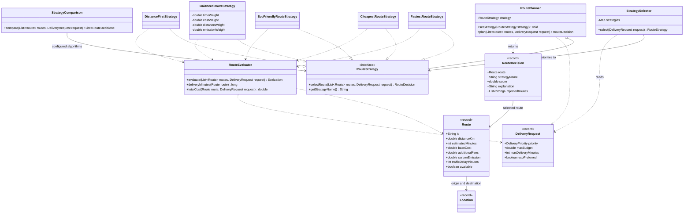
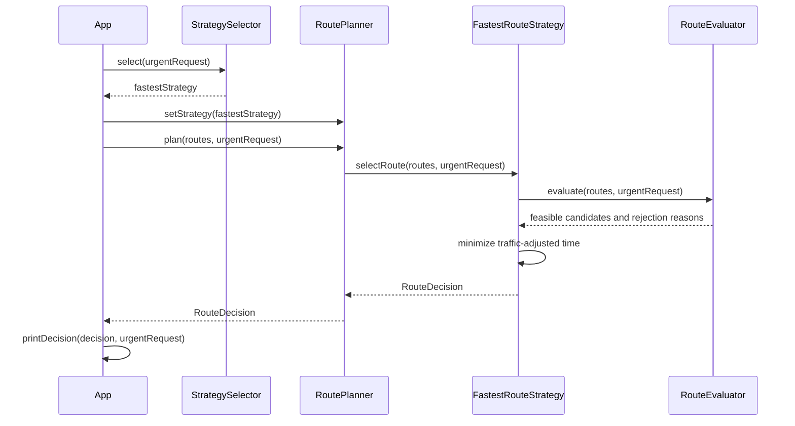

# Smart Delivery and Route Optimization Engine

Java 17 console application for Assignment 5. The application uses the Strategy Pattern to choose among eight predefined delivery routes according to delivery time, cost, environmental impact, a weighted balance, or distance.

## Run and test

Requirements: JDK 17 or newer and Maven. Run these commands from the project root:

```shell
mvn clean test
java -cp target/classes org.example.App
```

Alternatively, reload the Maven project in IntelliJ IDEA, run Maven's `test` lifecycle, and run `App.main()`.

The completed test suite has **24 tests**, all reported passing during development. After a fresh run, Maven prints a summary equivalent to:

```text
Tests run: 24, Failures: 0, Errors: 0, Skipped: 0
BUILD SUCCESS
```

## Problem and pattern

Different delivery requests need different route-selection algorithms. Urgent deliveries prioritize time, economy deliveries prioritize cost, and eco deliveries prioritize environmental impact. Keeping every algorithm inside one planner would force that class to change whenever an algorithm is added or modified.

The Strategy Pattern represents each algorithm as an interchangeable object implementing `RouteStrategy`. `RoutePlanner` delegates through that interface. The planner contains no strategy-name switch, type checks, or individual scoring algorithms.

Small conditions still enforce validation and business rules. The pattern removes algorithm branching from the context; it does not prohibit all `if` statements.

## Architecture

| Component | Responsibility |
|---|---|
| `RoutePlanner` | Context holding the current strategy and delegating `plan()` |
| `RouteStrategy` | Strategy interface defining `selectRoute()` and `getStrategyName()` |
| Five concrete strategies | Rank feasible routes using their own optimization rules |
| `StrategySelector` | Map request conditions to a strategy |
| `RouteEvaluator` | Calculate shared delivery metrics and enforce hard constraints |
| `StrategyComparison` | Execute its configured strategies for the same request |
| `RouteDecision` | Hold the selected route, strategy name, score, explanation, and rejection reasons |
| `DemoData` | Supply eight routes between the same origin and destination |
| `App` | Assemble components and demonstrate application behavior |

Domain types are immutable records: `Location`, `Route`, `DeliveryRequest`, and `RouteDecision`. `DeliveryPriority` is an enum. Constructors validate required values, geographic coordinates, and numeric ranges. Decision and evaluation lists are copied to prevent later modification.

`selectRoute()` returns `RouteDecision` instead of the assignment's example `Route`. This allows each strategy to return its choice and explanation together.

### UML class diagram

This diagram shows the principal classes and selected members. The strategies use the same evaluator, represented by a dependency from each strategy.



### UML sequence diagram

The successful urgent-delivery scenario follows `App.main()`. The selector returns a strategy; the existing planner is then configured to use it.



## Shared calculations and constraints

Cost is measured in KZT, time in minutes, distance in kilometers, and estimated emissions in kg of CO2.

```text
deliveryTime = estimatedMinutes + trafficDelayMinutes
urgentSurcharge = baseCost × 0.20 for URGENT; otherwise 0
totalCost = baseCost + distanceKm × 50 + additionalFees + urgentSurcharge
```

`estimatedMinutes` excludes the separately supplied traffic delay. The distance charge and surcharge are illustrative business settings.

Before scoring, `RouteEvaluator` rejects any route that is unavailable, exceeds the maximum budget, or exceeds the delivery deadline. It also rejects a computed non-finite cost. Budget and deadline equality are allowed. Rejected routes cannot influence the winning score or balanced normalization.

If the list is empty or no route is feasible, the evaluator throws `NoSuitableRouteException` containing rejection reasons. The console demonstrates catching it. Missing required references and invalid model values fail explicitly during validation.

## Concrete strategies

| Strategy | Value minimized |
|---|---|
| `FastestRouteStrategy` | Traffic-adjusted delivery time |
| `CheapestRouteStrategy` | Total delivery cost, including distance, fees, and urgent surcharge |
| `EcoFriendlyRouteStrategy` | `carbonEmission × 10 + distanceKm × 0.5` |
| `BalancedRouteStrategy` | Weighted sum of four normalized metrics |
| `DistanceFirstStrategy` | Distance in kilometers |

The eco formula belongs inside its strategy because it defines that algorithm's environmental preference. Shared cost calculation remains in `RouteEvaluator` so cost scoring and budget enforcement cannot disagree.

The eco coefficients are a heuristic: reducing emissions by 1 kg offsets an additional 20 km in the score. They do not represent a measured emissions model.

Balanced normalization is calculated separately for time, total cost, distance, and emissions across feasible candidates:

```text
normalizedValue = (value - minimum) / (maximum - minimum)

score = normalizedTime × timeWeight
      + normalizedCost × costWeight
      + normalizedDistance × distanceWeight
      + normalizedEmission × emissionWeight
```

If a metric is identical across candidates, its normalized value is zero. The default weights are `0.40, 0.30, 0.10, 0.20`. All weights must be finite and non-negative, and their sum must equal one within a `1e-9` floating-point tolerance. Invalid configurations throw `IllegalArgumentException`.

All strategies break equal scores by route ID. Strategy scores have different units and must not be compared directly across algorithms.

## Runtime switching and automatic selection

`App.main()` creates one planner and changes its strategy in the runtime-switching loop. With five registered strategies, it performs four switches on that same planner.

The automatic-selection section uses these mappings:

| Request priority | Strategy |
|---|---|
| `URGENT` | Fastest |
| `ECONOMY` | Cheapest |
| `ECO` | Eco-friendly |
| `STANDARD` | Balanced |

Urgency takes precedence over `ecoPreferred`. For other priorities, `ecoPreferred = true` selects the eco-friendly strategy. The selector stores the mappings in a map and accepts an alternative mapping through its constructor.

The distinction is responsibility: a Strategy decides **how to rank routes**, while the selector decides **which strategy to use**.

Requests affect both selection and feasibility. For example, the distance-first strategy selects `R5-Short` with a 60-minute deadline, but selects `R1-Express` when the deadline is reduced to 25 minutes.

## Example console output

Excerpt from comparison mode for `STANDARD`, maximum budget `5000`, deadline `60`, and `ecoPreferred = false`:

```text
Fastest -> R1-Express
Time: 22 min | Cost: 4100.00 KZT | Distance: 12.0 km | CO2: 4.00 kg
Strategy score: 22.0000

Cheapest -> R3-Economy
Time: 43 min | Cost: 1200.00 KZT | Distance: 10.0 km | CO2: 2.00 kg
Strategy score: 1200.0000

Eco-friendly -> R4-Electric
Time: 32 min | Cost: 1850.00 KZT | Distance: 11.0 km | CO2: 0.40 kg
Strategy score: 9.5000

Balanced -> R4-Electric
Time: 32 min | Cost: 1850.00 KZT | Distance: 11.0 km | CO2: 0.40 kg
Strategy score: 0.2313

Distance-first -> R5-Short
Time: 38 min | Cost: 2000.00 KZT | Distance: 7.0 km | CO2: 1.20 kg
Strategy score: 7.0000
```

The full application also prints strategy explanations and rejection reasons, including `R7-Closed: route is unavailable`. The automatic-selection and impossible-request sections demonstrate changing requests and explicit failure handling.

## Tests

| Test class | Tests | Coverage |
|---|---:|---|
| `FastestRouteStrategyTest` | 2 | Traffic-adjusted time and budget filtering |
| `CheapestRouteStrategyTest` | 2 | Total cost selection and urgent surcharge |
| `EcoFriendlyRouteStrategyTest` | 1 | Environmental score selection |
| `BalancedRouteStrategyTest` | 5 | Normalization, configurable weights, single candidate, invalid weights |
| `RoutePlanningTest` | 4 | Three runtime switches, automatic mappings, eco preference, urgent precedence |
| `StrategyComparisonTest` | 1 | Different selections for the same request |
| `DistanceFirstStrategyTest` | 2 | Fifth strategy and changed deadline |
| `RouteConstraintsTest` | 7 | Deadline, availability, exact boundaries, empty list, no valid route, negative values, missing request |
| **Total** | **24** | |

## Adding another strategy

1. Implement `RouteStrategy` in a new class.
2. Use `RouteEvaluator` to apply the existing constraints consistently.
3. Rank feasible candidates and return a `RouteDecision` with an explanation.
4. Register the strategy in the list assembled by `App` for comparison and demonstration.
5. Add tests. Configure a selector mapping if automatic selection should use it.

The fifth strategy, `DistanceFirstStrategy`, was introduced after the initial four-strategy application worked. Adding it required a new strategy class, its tests, and registration in `App`. No changes were needed in `RoutePlanner`, `RouteStrategy`, or `StrategyComparison`. The extension is recorded in a separate Git commit.

## SOLID principles

- **SRP:** planning, algorithm implementations, strategy selection, constraint evaluation, comparison, and console output have separate responsibilities.
- **OCP:** another algorithm can implement the existing interface without changing the context. The fifth strategy demonstrates this; application registration still requires a small configuration change.
- **DIP:** `RoutePlanner` depends on `RouteStrategy`, not concrete algorithms. Concrete strategies are assembled at the application and selector configuration boundaries.

## Strategy versus Bridge

Strategy exchanges algorithms within a context. Bridge separates an abstraction hierarchy from an implementation hierarchy so both can evolve independently. This project varies the route-selection algorithm used by a planner, so Strategy fits. It does not model two independently varying abstraction and implementation hierarchies.

## Limitations

The application selects from predefined routes rather than finding paths through a road network. It uses supplied traffic delays and estimated emissions rather than live measurements. Pricing and eco coefficients are fixed illustrative settings.

Balanced normalization depends on the feasible candidate set, so adding or removing a candidate can change relative scores. Its weighted sum expresses preferences rather than guaranteeing a uniquely optimal business outcome.

Selector priorities are enum values; adding a new priority requires changing that enum and its configuration. The current explanation lists cover the winner and hard-constraint rejections, rather than a complete score breakdown for every feasible alternative. All strategies share the same constraints; per-delivery prohibitions and emission limits would require additional model and policy support.
